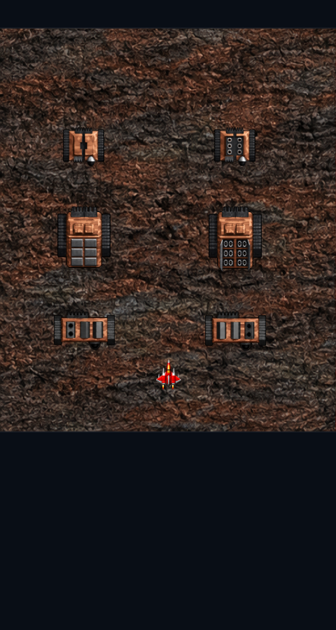

# M2.24 三色溢出弹与地面炮门 / Color overflow and ground shutters

## 范围与证据 / Scope and evidence

用户于 2026-10-13 要求核对满级同色球/S 的消弹，以及第 2、4 关固定炮台开合盖；原作证据明确即修复。依据本地 DemonStar 4.04，EXE SHA-256 为 `d3d9d0205b069e5d134fdedba7b9fbd74ebcafd9785b7c9ce3d2e5ed847691b2`。本轮实际查看本地原作的 32 帧炮门图；金标既有第 2/4 分集抽样只作对象定位，未新增视频观看或声称逐帧录像时长认证。

On October 13, 2026, the user authorized evidence-backed fixes for full-tier same-color/S overflow cancellation and stage-2/4 turret shutters. Evidence comes from the local DemonStar 4.04 binary with the SHA-256 above. All 32 local source shutter frames were inspected. Previously recorded video samples identify objects; this round adds no video-viewing claim or frame-exact video timing certification.

## 三色溢出弹 / Color-overflow volleys

- 原程序 `0x429980` 二级分派表将 45/46/47 分别送至 `0x42a0a0 / 0x42a151 / 0x42a231`，发出黄 16、蓝 32、红 64 发。模板更新模式均为 0；友方碰撞 `0x4286d4–0x42872f` 调用 `0x4114c0` 攻击敌机，模式 0 的移动/收尾没有敌弹碰撞删除。
- `0x428d42–0x428da0` 炸弹爆炸分支另设消弹标记，`0x428dd6–0x428de2` 据此调用 `0x4285d0`。不能把这个炸弹能力套给三色溢出弹。
- 旧重制版在每颗 `nova` 飞行时扫描敌弹并标为死亡；旧回归也误将此行为写成正确预期。本轮只移除三色 45/46/47 的相交消弹，并将该回归改为保留敌弹与后续玩家受伤验证。保留弹量、弹速、伤害、拾取规则、玩家归属、三色保留扩展和炸弹机制；磁力溢出旧行为未纳入本轮。

- The native constructor table routes types 45/46/47 to the addresses above and emits 16/32/64 projectiles. Their update mode is zero. Friendly collision calls the enemy-damage helper; their movement/cleanup path does not cancel hostile shots.
- Bomb explosion code separately sets a clearing flag and calls the global projectile-clear helper. That ability must not be assigned to color overflow.
- The remake explicitly killed hostile shots crossed by any nova, and an old regression encoded that assumption. This change removes crossing cancellation only for the three colors and corrects the regression to verify survival and subsequent player damage. Counts, speed, damage, pickup rules, ownership, retained-color extension and bombs remain unchanged; magnetic overflow remains outside scope.

## 原作炮门 / Native shutters

| 定义 / Definition | 本次反馈关卡 / Reported stages | 原作帧 / Source frames | 原作计时 / Source counters |
|---|---|---|---|
| 88 G_TNK2A | 2 / 4 | Game.glb 1225–1230，6 帧 / poses | interval 1, initial pause 200, end/start pause 30/30, ping-pong, cycles 999 |
| 89 G_TNK3A | 4 | Game.glb 1231–1236，6 帧 / poses | interval 1, initial pause 200, end/start pause 30/30, ping-pong, cycles 9 |
| 185 G_BTANK1A | 4 | Game.glb 1436–1455，20 帧 / poses | interval 1, initial pause 250, no endpoint pause, cyclic, cycles 999 |

`SHIPDEFS_DAT` 的 +64/+66/+68/+70/+72/+82/+84 分别为动画间隔、初始暂停、循环帧数、轮数、起始帧、尾/首暂停；0x10000 为往返标志。`0x4102bd–0x41038c` 的计数器与现有动画调度一致。短炮台在第 202 次更新开始开盖，第 210 次到完全开启，第 244 次开始合盖；这只是源逻辑步数，不是手机墙钟测量。

The source animation fields and ping-pong flag drive the existing state machine. Native counter handling matches its update order. Small shutters first advance on tick 202, reach fully open on tick 210 and start closing on tick 244. These are source logic ticks, not measured phone wall time.

原作炮门动画之后独立调用炮位更新 `0x4103b1 → 0x40f770`；没有添加“只有开到某帧才允许开火”的新门槛。后续四难度核对发现旧版 1.3/1/0.85/0.7 冷却倍率使三档中的后续齐射落到闭盖帧；现仅对这三类使用原表 84/40 步间隔，保留炮位数、初始延迟、轮数与伤害，其他敌机的既有倍率不动。两种开合盖与三列轮换炮门均补齐显式帧映射，按每帧原始边界绘制、按关加载/释放。相同原型在其他关卡复用该修复。已有动画快照传输状态，房间规则提升为 10，双方须更新。

Native gun updates run independently after animation. No new frame-based firing gate is introduced. A follow-up four-difficulty check found that legacy 1.3/1/0.85/0.7 cooldown multipliers moved later volleys into closed poses. Only these three families now use their native 84/40-tick periods; muzzle counts, initial delays, cycles and damage remain unchanged, as do other enemies' existing multipliers. All three families use explicit redraw frames at source bounds, loaded/released per stage. Other stages sharing the same prototypes receive the fix. Existing snapshots carry animation state; room revision 10 requires both peers to update.

素材与完整提示词见 [重绘记录 / Art provenance](ART_M2_24_SHUTTERS.md)。原图不发布，高清内纹与门板细节仍属重绘近似。

## 验收范围 / Verification scope

发布版本为 0.2.24 / build 26，适用验收通过；最终报告及失败历史见下文。 / Release 0.2.24 / build 26 passed applicable verification; see final results and retained failure history below.

本轮按用户认可的影响范围选测：保留廉价全量引擎回归；浏览器覆盖通用启动、装备/武器、全战役美术、受伤美术、战斗表现、Boss 损毁、地物、斜弹、LAN、激光预警和新增炮门，共 12 组。Android 保留构建/Lint、安装启动、双 App LAN、操作及新增打包探针；独立设置与语言专项因实现未变本轮跳过，脚本保留。iOS 仍采用现有完整同轮构建/功能/触控/LAN workflow，附加相同新探针。跳过不计作本轮通过。

Impact-based selection retains the inexpensive full engine suite and twelve browser suites: startup, equipment/weapons, campaign art, damage art, presentation, boss death, structures, ground missiles, LAN, laser warnings and new shutters. Android retains builds/Lint, installation/startup, native paired LAN, controls and the new packaged probe. Dedicated settings/localization suites are skipped because those implementations are unchanged; their scripts remain. iOS retains the existing complete same-run build/functional/touch/LAN workflow with the new probe. Skipped checks are not counted as current passes.

新增定向检查包括 96 种四难度×规则×玩家×颜色×拾取组合；敌弹穿越后仍伤害玩家；32 帧实绘；18 关资源加载；炮门起停/轮数/暂停与 LAN 状态；四难度三原型各 1000 步炮火与普通档原表同炮位轨迹对照，并要求两类开合盖炮台只在完全打开的帧发射。原作定义与武器/弹体数值表保持字节不变。

Focused checks cover 96 difficulty/rule/player/color/pickup combinations, hostile damage after crossing overflow, all 32 rendered frames, stage-scoped resources across eighteen stages, shutter timing/cycles/pause/LAN, and 1000-tick gun traces for three prototypes across four difficulties against identical source-period guns, also asserting that both opening-cover families fire only when fully open. Original campaign and weapon/projectile numeric tables remain byte-identical.

首次新增浏览器检查在手动加载第 4 关图集时仍让 App 显示第 1 关，渲染循环正确地换回第 1 关，导致等待超时。已修正测试场景同步切关，保留失败日志与所有断言；没有放宽等待或改动产品加载规则。 / The first new browser check loaded stage-4 art while the app still displayed stage 1, whose render loop correctly restored its assets. The fixture now switches the game stage too. Failed logs and all assertions are preserved; product loading and timeout limits are unchanged.

## 炮门与齐射的补充核对 / Shutter-volley follow-up

原作 `0x4028de–0x402901` 复制定义表，`0x40f050–0x40f0d6` 将每炮位 36 字节复制到实例并初始化运行计数，`0x40f83d–0x40f84a` 直接从定义 +12 取下一轮冷却。已核对难度变量 `0x43ca9c / 0x43caa0` 的引用，这条装载/炮位链路没有难度倍乘。对应两种开合盖炮台周期为 84 步，轮换炮门为 40 步。范围只限 ID 88/89/185，不借此宣称全部敌机射击已经 1:1。

Native loading copies definitions and each 36-byte gun record, initializes runtime counters, then reloads cooldown directly from definition offset +12. References to the difficulty globals do not introduce a multiplier in this loading/gun chain. The two opening-cover families use 84-tick periods; the rotary family uses 40. This correction is limited to IDs 88/89/185 and does not certify every enemy's firing fidelity.

旧候选 iOS 38319059462 在此新增问题确认后主动停止，不作为发布验收。新的本地与原生探针增加十二种炮台/难度组合的原表周期及闭盖不发射断言。 / Candidate workflow 38319059462 was deliberately cancelled when this additional issue was confirmed and is not release evidence. New local/native probes add twelve prototype/difficulty cases for source periods and no closed-cover firing.

## iOS 房主启动恢复 / iOS host-startup recovery

运行 38320498041 完成设备构建、iPhone/iPad 功能与新探针；功能阶段两次未生成探针的启动超时经既有恢复后继续通过。随后 LAN 房主的 `simctl launch --lan-probe` 等待 180 秒超时，未生成 LAN 探针，尚未进入联机断言；整轮失败，触控未执行。失败日志保留，不拼接成完整通过。

Run 38320498041 passed device compilation, iPhone/iPad functionality and new probes. Two startup timeouts without probe results recovered under the existing policy. LAN host launch then timed out after 180 seconds without a LAN probe, before gameplay assertions; the workflow failed and touch did not run. Preserve the failed evidence without merging partial results into a pass.

为这一个明确的启动缺口复用现有 CoreSimulatorService 恢复：仅房主尚无探针时允许一次服务恢复及同设备冷启动，保留应用、数据和探针脚本；已有结果交由原有断言判定，非超时错误、再次超时、恢复期间出现的迟到结果均不重试。客机及联机断言不重跑；同一 workflow 最多三次服务恢复的上限不变。十四项独立边界测试覆盖旧路径与新增分支，游戏实现不因此改变。

Reuse bounded CoreSimulatorService recovery only for this observed startup gap: one service recovery and cold boot on the same device are allowed before any host probe exists, preserving app/data/script. Existing results go through normal assertions; non-timeout errors, a second timeout and late results during recovery stop without relaunch. Guests and gameplay assertions are not retried; the existing three-service-recovery workflow limit remains. Fourteen boundary tests cover old and new paths without modifying gameplay.

下一轮 38323226032 在 iPhone 三种语言功能后，于 iPad 重装准备中的 `simctl terminate` 60 秒超时；尚未进入该 iPad 用例及 LAN/触控。这是另一条尚未接入服务恢复的准备路径：`install_clean` 原先只冷启动设备，现先调用相同的有界服务恢复，再冷启动原设备。不增加重试次数或全轮恢复上限，不重试应用断言。边界测试扩展至十七项；游戏、Android 与浏览器源码/结果不变。

Run 38323226032 completed the three iPhone locale cases, then timed out for 60 seconds in iPad `simctl terminate` during reinstall preparation, before that iPad case or LAN/touch. `install_clean` previously only rebooted the device; it now invokes the same bounded service recovery before rebooting that device. Retry counts, the workflow-wide recovery cap and application assertions stay unchanged. Seventeen boundary tests cover the preparation/launch paths; gameplay and Android/browser inputs/results are unchanged.

## 最终结果 / Final results

- 三色满级后再吃同色球或 S，仍释放原数量/伤害的环形弹幕，但不会抵消敌方子弹；炸弹行为不变。
- 第 2/4 关相关 G_TNK2A、G_TNK3A、G_BTANK1A 恢复 6/6/20 帧开合盖与轮换炮门；使用重绘素材及原作计时，炮位/伤害不变，三类炮台按原表间隔开火。同原型的其他关卡同步生效。
- 版本 0.2.24 / build 26，房间规则 10，联机双方须更新。

413 项引擎测试、12 组适用浏览器检查通过；包括 96 种溢出拾取组合、32 帧实绘、18 关资源加载、炮门暂停/联机，以及四难度三种炮台各 1000 步原表炮火对照。Android Release/Debug/Lint（0 错误）、API 37 安装/启动、双 App LAN、操作及新增探针通过。[同轮 iOS CI](https://github.com/Hashiao/DemonStar-Reborn/actions/runs/38325523355) 完成 iPhoneOS 构建、iPhone/iPad 功能/三语/音频与新增探针、系统触控及原生 LAN。两包版本和完整 Web 资源核验一致。

按影响范围选测，未变的 20 组浏览器专项及 Android 独立设置/语言专项本轮跳过，脚本保留，不记为本轮通过。原始数值表与音频实现不变。IPA 未签名，须自行签名；未认证手机真机、真实热点或 Android–iOS 真机混联。高清炮门为重绘，未宣称原像素或金标录像逐帧时长一致。

- Full-tier same-color/S pickups retain their original volley counts and damage, while color overflow no longer cancels hostile shots. Bomb behavior stays unchanged.
- G_TNK2A, G_TNK3A and G_BTANK1A used in stages 2/4 gain 6/6/20 cover and rotary-shutter frames with source timing and redrawn art. Muzzles and damage are unchanged; source firing periods are restored for these three families; other stages sharing these prototypes receive the fix.
- Version 0.2.24 / build 26; room revision 10 requires both peers to update.

Passed 413 engine tests and twelve applicable browser suites, including 96 overflow-pickup combinations, 32 rendered frames, eighteen-stage asset loading, shutter pause/LAN state and 1000-tick source-gun comparisons for three prototypes across four difficulties. Android Release/Debug/Lint (zero errors), API 37 installation/startup, native paired LAN, controls and new probes passed. [Same-run iOS CI](https://github.com/Hashiao/DemonStar-Reborn/actions/runs/38325523355) completed iPhoneOS compilation, iPhone/iPad functionality/localization/audio and new probes, system touch and native LAN. Package versions and complete Web resources match.

Impact-based selection skips twenty unchanged browser suites and dedicated Android settings/localization checks this round. Scripts remain, and skips are not counted as passes. Original numeric tables and audio implementations are unchanged. The IPA is unsigned and needs user signing; physical phones, hotspots and Android–iOS hardware pairs are not certified. Shutters are HD redraws, not pixel-identical artwork or frame-exact video timing.

`DemonStar-Reborn-release.apk` SHA-256: `b0dad2eedb65cbe4c84caa3a0529349ac1569c78d7bc976b5a1b90c55c5a27d5`

`DemonStar.ipa` SHA-256: `38840a34edfb08f71852c0a66e1b68475460cfdc595daf646e5a4aa45c5ee457`

Android 初次启动后宿主退出，第二次在启动 UI 检查前设备断开；第三次采用同一 AVD、兼容软件渲染并禁用 Vulkan，通过全部选定检查。前两次不计通过，保留日志。 / The emulator exited after the first boot and disconnected before UI assertions on attempt two. The same AVD passed all selected suites using compatibility software rendering with Vulkan disabled on attempt three. Earlier attempts remain failed and logged.

首轮 iOS 38318138123 的设备构建通过；首个 iPhone 探针完成 23 张图集解码及新增 96 组合，但控制脚本仍断言旧数量 21，整轮失败，后续功能/LAN/触控未完成。已改为精确核对当前资源清单，再跑完整同轮验收。保留失败记录，不拼接旧结果。 / First iOS run 38318138123 built the device app and its first iPhone probe decoded 23 atlases and passed the new 96 cases. The controller still required the old count 21, so the workflow failed before the remaining functional/LAN/touch checks. The controller now checks the exact current manifest, followed by a fresh complete workflow. Failed evidence remains separate.

最终成功 workflow 的控制服务恢复次数：0；全部恢复记录随验收报告保留。 / The successful workflow recorded 0 control-service recoveries; the verification report retains every recovery.

最终成功轮未触发服务恢复；恢复分支的限制由十七项边界测试覆盖，未宣称已彻底消除所有模拟器启动问题。 / No service recovery was triggered in the successful run. Seventeen boundary tests cover the recovery policy; this is not proof that all simulator startup issues are eliminated.
