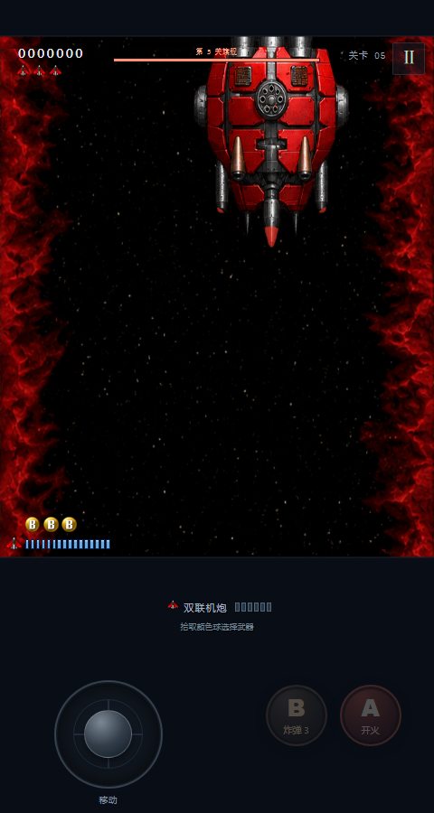

# M2.25 炮口激光预警 / Laser muzzle warning

2026-10-15，0.2.25 / build 27，房间规则仍为 10。
2026-10-15; version 0.2.25 / build 27; room revision remains 10.

## 用户确认的行为 / Confirmed behavior

简单难度的 Boss 红、蓝激光，在每轮发射前一秒，仅对应炮口附近机体变红闪烁，频率由慢到快。发射的同一逻辑步，预警撤销，炮口恢复正常。取消沿光束路径的透明预演、渐深和原光束节奏闪烁。现有默认开启的本机预警开关继续生效。

For Easy Boss red and blue lasers, only the body around each upcoming muzzle blinks red during the second before a volley, accelerating toward emission. The warning ends on the firing tick and the muzzle returns to normal. Full-path translucent previews, fading and beam-pattern pulses are replaced. The existing default-on local warning checkbox remains effective.

这是用户指定的辅助显示，不是声称原作自带的效果。运行时代码只改 `render-hd.js`；原枪位预测、射击计时、伤害、激光原色及网络快照均保持原样。旧快照的脉冲字段继续兼容，不另增房间协议版本。

This is user-requested assistance, not an original-game claim. Runtime changes are confined to `render-hd.js`; muzzle prediction, firing timing, damage, live laser colors and snapshots remain unchanged. Existing pulse fields remain compatible, without a room protocol bump.

炮口区域为实际发射坐标周围半径 12 游戏单位，裁剪并复用现有机体红色染色，只对已有机体像素生效。亮时颜色固定，暗时显示正常机体；一秒内相位为 `2t+3t²`，频率从 2 Hz 连续升至 8 Hz。暂停沿用游戏剩余时间，不用墙钟推进。

The region is a radius of 12 game units around the actual emission point, clipping the existing red body tint to existing sprite pixels. Lit tint is constant and dark phases show the normal body. Phase `2t+3t²` increases frequency continuously from 2 to 8 Hz over one second. Pause uses remaining game time rather than wall-clock animation.

## 本轮验收边界 / Verification scope

用户在开发中明确要求：“简单测试一下boss的激光就发APK和ipa包 不要做太多测试浪费时间”。此要求覆盖本轮旧的完整发布验收约定。

During development the user explicitly requested a simple Boss laser check followed by APK/IPA delivery, avoiding extensive testing. That instruction overrides the former full-release verification requirement for this release.

自动审批最初拦截 main 推送；用户随后明确补充授权：“允许仅凭激光专项检查推送 main”，并继续构建 IPA、发布两个包。未以改分支或其他方式绕过拦截。
Automatic approval initially blocked the main push. The user then explicitly authorized pushing main after only laser-specific checks, continuing the IPA build and publishing both packages. No alternate branch or indirect action bypassed the block.

- 已通过：6 项现有激光逻辑检查（约 0.26 秒），包含 12 个 Boss 的 132 个炮位/难度组合、发射交接、无伤害、暂停、死亡/换关清理及快照；1 组浏览器实际 Canvas 检查（约 2.2 秒），含红蓝局部红闪、固定色调、递增频率、发射边界恢复、预警开关与暂停。
- Passed: six existing laser logic checks (~0.26 s), covering 132 gun/difficulty cases across twelve Bosses, emission handoff, harmlessness, pause, death/stage cleanup and snapshots; one actual Canvas browser suite (~2.2 s), covering both colors, local fixed red tint, increasing blink frequency, restoration at emission, warning toggle and pause.
- 跳过：其余引擎与浏览器专项、Android Debug/Lint/模拟器、iOS 模拟器功能/触控/LAN、真机及热点。本轮不复用 M2.24 的通过记录冒充当前结果。
- Skipped: remaining engine/browser suites, Android Debug/Lint/emulator checks, iOS simulator functional/touch/LAN checks, physical devices and hotspots. M2.24 results are not reused as current passes.
- 脚本保留。iOS 工作流新增手动 `laser-package-only` 选项，仅构建包；默认 `full` 保持完整检查。仅本次提交跳过自动 CI，再显式启动所需范围，避免重复构建。
- Scripts remain. The iOS workflow adds a manual `laser-package-only` package-build option; default `full` retains all checks. Only this commit skips automatic CI, followed by an explicit scoped run to avoid duplicate builds.

## 打包结果 / Package results

- Android Release 构建通过（Gradle 15 秒），独立签名证书与前版一致；仅 assembleRelease 自带必要校验，未运行完整 Lint。
- Android Release build passed (15 s in Gradle), using the same independent project certificate. Only assembleRelease's built-in checks ran, without full Lint.
- [iPhoneOS 构建 / iPhoneOS build](https://github.com/Hashiao/DemonStar-Reborn/actions/runs/38729195319)通过，ARM64、iOS 12.0 部署目标、0.2.25/build 27。工作流中的完整引擎与模拟器步骤均明确跳过。
- The iPhoneOS build passed: ARM64, iOS 12.0 deployment target and 0.2.25/build 27. Full engine and simulator steps are explicitly skipped in the workflow.
- 两包全部 144 份 Web 文件与本地构建匹配；仅 HTML/CSS 允许等价 CRLF/LF。IPA 未签名，需自行签名；最低目标不等于本轮实机验证。
- All 144 Web files match the local build in both packages, allowing equivalent CRLF/LF only for HTML/CSS. The unsigned IPA requires user signing; deployment targets are not physical-device verification.

| 文件 / File | SHA-256 |
| --- | --- |
| DemonStar-Reborn-release.apk | `cd3adbb04002eb5344aa037788f0ce575b021a3cd82cc1f8bfdbcbd1ceb47d46` |
| DemonStar.ipa | `e2853f0b0e573f9c57f017415176cb9a91993b7bbec322dde63ade0cbf0a1c2f` |

公开下载完整性由发布工具按 SHA-256 核对；本地结果保存在 `.local/m225-public-verification.json`。本轮没有宣称完整回归或原生运行验收通过。
The publisher checks public downloads against SHA-256; local evidence is stored in `.local/m225-public-verification.json`. This release does not claim full regression or native runtime verification.
