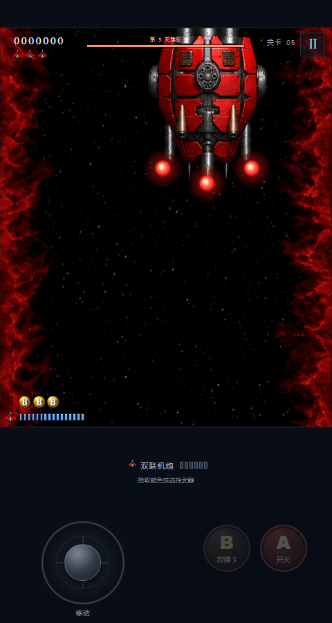

# M2.26 激光炮口蓄能光球 / Charging laser muzzle orbs

2026-10-15，0.2.26 / build 28，房间规则 10。
2026-10-15; version 0.2.26 / build 28; room revision 10.

简单难度 Boss 红、蓝激光的发射前一秒，原 M2.25 局部机体染红改为对应炮口上的红色蓄能光球。光球的明暗与大小脉动幅度逐渐增大，频率从 2 Hz 连续升至 10 Hz，临近发射形成强烈收缩/膨胀的蓄能感。激光射出的同一逻辑步，光球消失。现有默认开启的本机开关继续生效。

During the second before Easy Boss red/blue lasers, M2.25's local body tint is replaced by a red charging orb at the upcoming muzzle. Brightness and size pulse amplitudes grow as frequency continuously increases from 2 to 10 Hz, producing strong late contraction/expansion. The orb vanishes on the firing tick. The existing default-on local toggle remains effective.

光球用 Canvas 径向渐变生成，暖白内核、红色外层和柔和光晕；不增加图片资源。进度 `t` 的积分相位为 `2t+4t²`，球半径与亮度的峰谷差随进度扩大，最大球半径 12 游戏单位、光晕半径 27.6。暂停使用游戏剩余时间，跟随真实炮口，不按墙钟推进；不会发生额外爆炸、弹体或伤害。实际激光颜色、时机、伤害和网络协议均不变。

Canvas radial gradients provide a warm white core, red outer sphere and soft halo without new image assets. Integrated phase is `2t+4t²`; radius and brightness peak-to-trough differences increase with progress. Maximum core radius is 12 game units, with a 27.6-unit halo. Animation follows remaining game time and the real muzzle, freezing on pause. It creates no extra explosion, projectile or damage. Live laser colors, timing, damage and the network protocol remain unchanged.

## 授权与有限检查 / Authorization and limited checks

用户本轮明确授权“只测试这个推送main 发APK和IPA”。仅运行现有 6 项激光逻辑检查及 1 组实际 Canvas 浏览器检查；其余引擎/浏览器、Android Debug/完整 Lint/模拟器、iOS 模拟器功能/触控/LAN 跳过，原脚本与默认完整流程保留。跳过不记通过，也不借用历史验收冒充本轮结果。

The user explicitly authorized testing only this change, pushing main and publishing APK/IPA. Run only the existing six laser logic checks and one actual Canvas browser suite. Skip other engine/browser suites, Android Debug/full Lint/emulator and iOS simulator functional/touch/LAN checks; retain their scripts and the default full workflow. Skips and historical results are not current passes.

专项覆盖红蓝光球相同、明暗/大小脉动幅度递增、频率加快、范围局限炮口、发射消失、无预演光束、实际激光交接、暂停、开关及快照。初次浏览器启动因上轮本地服务已停止而连接失败；重启服务后通过，失败日志保留，不涉及应用断言失败。

Targeted checks cover matching red/blue warning orbs, growing brightness/size pulse amplitudes, increasing frequency, muzzle-local bounds, removal at emission, absence of preview beams, real-laser handoff, pause, toggle and snapshots. The first browser attempt failed to connect because the previous local server had stopped. It passed after starting the server; the failed log remains, with no application assertion failure.

## 结果 / Results

6 项激光逻辑检查与 1 组浏览器实绘通过。按预警进度采样，两种光球的画面总光强峰值均位于 0.315、0.505、0.655、0.780、0.895 秒，峰间距离逐渐缩短；这是渲染采样，不是真机墙钟实测。后段明暗/大小脉动幅度明显大于前段，发射边界无光球像素。
Six laser logic checks and one rendered browser suite passed. Sampling warning progress gives total rendered pixel-intensity peaks at 0.315, 0.505, 0.655, 0.780 and 0.895 seconds for both colors, with shrinking intervals; these are render samples, not physical-device wall-clock measurements. Late brightness/size pulse amplitudes exceed early amplitudes, and no orb pixels remain at emission.

Android Release 构建、独立签名核对及 [iPhoneOS 包构建](https://github.com/Hashiao/DemonStar-Reborn/actions/runs/38735359758)通过。0.2.26/build 28，两包全部 144 份 Web 文件匹配。本轮没有原生运行或真机验收；IPA 未签名，需自行签名。
Android Release compilation, independent signing checks and the iPhoneOS package build passed. Both are version 0.2.26/build 28 with all 144 Web files matching. Native-runtime and physical-device verification were not performed this round; the unsigned IPA requires user signing.

| 文件 / File | SHA-256 |
| --- | --- |
| DemonStar-Reborn-release.apk | `282f8783655f514d74088288dd02d00b0309f7c389afff7ce303990b1a7ea323` |
| DemonStar.ipa | `8fa3474b26b780ff601fbabc2b9bec13c764065d1e7b530b907b9f9dd6f3411f` |

公开下载由发布工具核对完整 SHA-256，记录保存于 `.local/m226-public-verification.json`。
The publisher checks complete public-download SHA-256 hashes, with evidence in `.local/m226-public-verification.json`.
