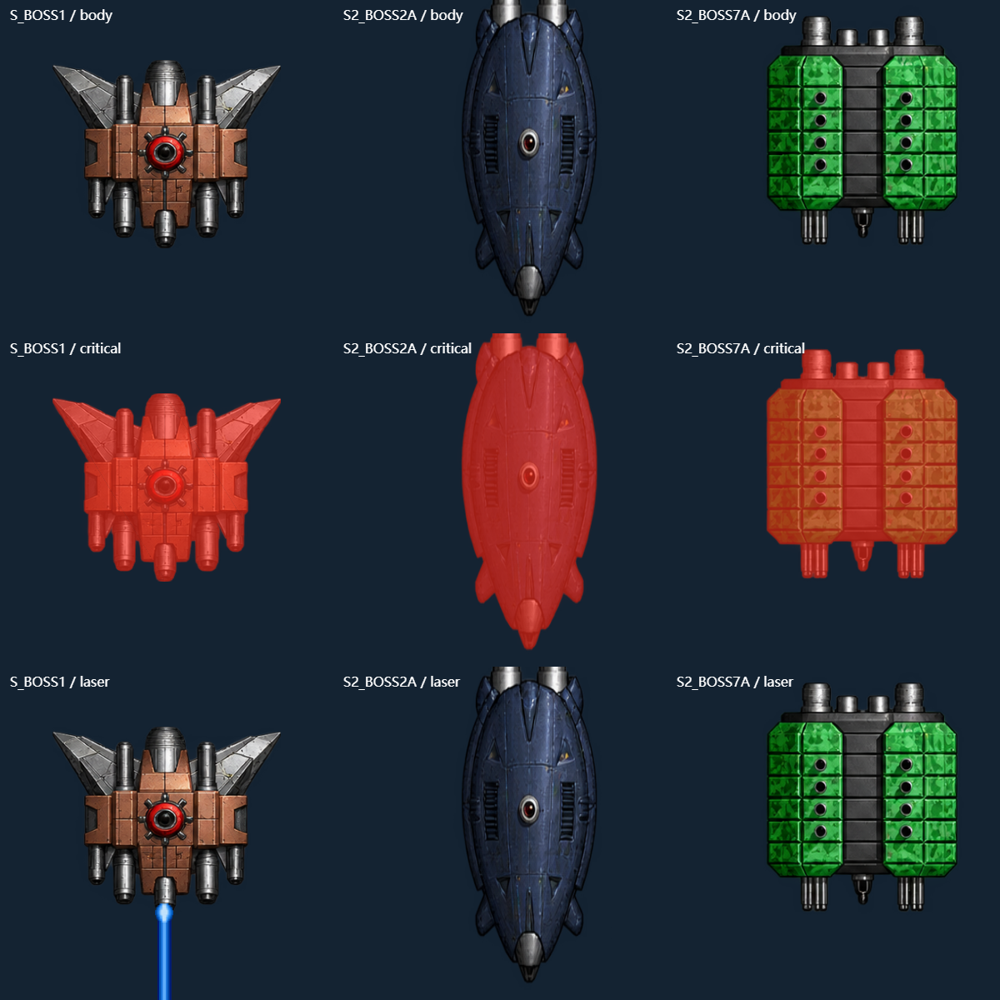

# M2.28 Boss 图集碎块清理 / Boss atlas fragment cleanup

2026-10-15，0.2.28 / build 30，房间规则 10。
2026-10-15; version 0.2.28 / build 30; room revision 10.

## 依据与修正 / Evidence and changes

第 8 关蓝色细片来自同一图集中第 7 关机体的右缘；第 13 关左侧灰块来自第 12 关翼缘。旧等分 4×3 裁切包含了这些相邻像素。用明确裁切排除邻格，同时把裁切坐标换算回旧绘制矩形，保留本体位置、尺寸与纵横比例。

The blue sliver beside stage 8 comes from the stage-7 body's right edge in the same atlas; the gray block beside stage 13 comes from stage 12's wing. Uniform 4×3 cells included those neighboring pixels. Explicit crops exclude them and map back into the previous drawing rectangle, preserving body placement, size and aspect ratio.

第 1 关嘴下三片金属块可用 M2.27 之前的等分 4×4 裁切复现；M2.27 的明确裁切已排除这些块，当前普通/闪红/激光场景未复现该大块残片。本轮进一步将所有已配准激光 Boss 以及本次第 8/13 关的本体复制到独立纹理，再进行缩放/分片绘制，防止图集边缘采样带入邻格；换关释放缓存。

The three metal pieces below the stage-1 muzzle reproduce with the pre-M2.27 uniform 4×4 crop. M2.27's explicit crop already excludes them; current normal/red-flash/laser scenes did not reproduce those large fragments. This release additionally isolates every registered laser Boss and the stage-8/13 bodies into individual textures before scaling/patch rendering, preventing atlas-edge sampling from including neighbors. Stage changes release the cache.

原 PNG、原作数值表、炮口配准控制点、光球颜色/脉动、发射时机、真实弹体和碰撞、音频与玩家操作均不改。清理是运行时裁切/采样修正，不是再次重绘机体。数值清单见 [boss-clean-crops.json](boss-clean-crops.json)。

Original PNG bytes, source numeric tables, muzzle registration controls, orb colors/pulses, firing timing, physical projectiles/collisions, audio and player controls remain unchanged. This is a runtime crop/sampling correction, not a new body redraw. See the numeric crop manifest.

## 完整验收要求 / Full verification requirement

用户明确要求清理后进行完整 iOS、Android 测试再发包。本轮恢复完整流程，不沿用 M2.25–M2.27 的有限验收例外。计划执行全量引擎与浏览器、Android Debug/Release/Lint 和现有模拟器全部测试脚本、同一次 iOS 构建/功能/三语/音频/系统触控/原生 LAN。失败和未执行项目不得记通过，也不拼接不同失败轮次的 iOS 成功步骤。

The user explicitly requests complete iOS/Android testing before release. Restore the full workflow; M2.25–M2.27's limited-verification exceptions do not apply. Run all engine/browser checks, Android Debug/Release/Lint and existing-emulator test scripts, plus a single successful iOS build/functionality/localization/audio/system-touch/native-LAN run. Failures and unexecuted checks are not passes, and successful steps from different failed iOS attempts are not combined.

新增包内像素探针覆盖第 1/8/13 关、3 个缩放、普通/闪红、整数/小数位置；首关另检查四个蓝激光帧，共 84 个场景。旧错误裁切必须能检测出碎块，当前绘制在指定碎块区域必须为零，并确认本体仍显示、换关缓存释放。浏览器、Android WebView 和 iOS WKWebView 使用相同探针。

A new packaged pixel probe covers stages 1/8/13, three scales, normal/red states and integer/fractional positions, with four blue-laser frames additionally checked for stage 1: 84 scenes. The old incorrect crops must produce detectable fragments; current rendering must leave zero fragment pixels in the specified regions while retaining the body and releasing caches on stage change. Browser, Android WebView and iOS WKWebView use the same probe.

原生 `file://` 图片绘制允许显示，但 Android 禁止直接读回该 Canvas 像素。显式原生测试从实际 APK / iOS Bundle 提取同一 PNG 字节，以 data URL 解码后执行像素断言，再恢复原资源；不改变 WebView 安全设置或正式显示路径。异步解码完成前不切换测试画布，避免主渲染循环把文件图片混入测试画布。包内全部 Web 资源仍须与构建逐项匹配。

Native `file://` images can render, but Android forbids direct Canvas pixel readback. Explicit native tests extract identical PNG bytes from the actual APK/iOS Bundle, decode them as data URLs for pixel assertions, then restore the original resources. WebView security settings and production rendering paths remain unchanged. The probe switches canvases only after asynchronous decoding so the main loop cannot mix file images into the test canvas. Every packaged Web resource must still match the build.

保留本地验收中遇到的测试入口问题：旧浏览器脚本读取 `TEST_URL` 而运行器提供 `GAME_URL`，已兼容两者；Debug 包 Activity 类名不含 `.debug` 后缀，已修正本地启动器；像素探针的文件来源限制及异步画布竞争均有失败日志。只补跑受影响项目，其余通过结果对应未变的应用代码，不删除或放宽功能断言。

Preserve local test-entry failures: the legacy browser script read `TEST_URL` while the runner supplied `GAME_URL`, now supporting both; the Debug Activity class does not contain the `.debug` application-ID suffix, corrected in the local launcher; the pixel probe's file-origin limitation and asynchronous canvas race retain failed logs. Rerun affected checks only; other passes apply to unchanged app code without deleting or weakening functional assertions.

首轮完整 iOS 流程 [38752416327](https://github.com/Hashiao/DemonStar-Reborn/actions/runs/38752416327) 的 iPhone 三语功能及新探针通过；iPad 在探针启动前多次 `simctl` 启停超时，触发全轮三次恢复上限并失败，LAN/触控未执行。保留日志和失败状态，不增加恢复次数；使用同一源码在新执行器完整重跑，不拼接首轮的局部成功。

In the first full iOS run, iPhone functionality in three languages and the new probes passed. Repeated iPad `simctl` launch/termination timeouts before its probe exhausted the workflow-wide three-recovery limit; the run failed and LAN/touch did not execute. Preserve the logs and failed state without increasing the recovery cap. Repeat the complete workflow for the same source on a fresh runner, without combining partial successes from the failed run.

## 最终验收 / Final verification

- 413 项引擎、33 组浏览器、17 项 iOS 恢复边界检查通过。
- Android Debug/Release 构建及两种 Lint 零错误；API 37 安装回读、启动/旋转/后台、设置、三语、原生桥、TCP 游戏客户端、双 App LAN、操作与包内探针共 7 组通过。
- [同一次 iOS 流程](https://github.com/Hashiao/DemonStar-Reborn/actions/runs/38755918762)通过设备构建、iPhone/iPad 功能/三语/音频/新探针、系统触控和原生 LAN。恢复服务记录保留在公开报告中，不将模拟器时钟当作真机听感或热点认证。
- 三端 84 个场景的指定碎块区域均为零，旧裁切阳性对照仍能检测出碎块。本轮未跳过现有测试组。

- Passed 413 engine tests, 33 browser suites and 17 iOS recovery boundary checks.
- Android Debug/Release builds and both Lint variants have zero errors. Seven API 37 suites passed installation/readback, startup/rotation/background behavior, settings, localization, native bridge, TCP game client, paired native LAN, controls and packaged probes.
- The same iOS run passed device compilation, iPhone/iPad functionality/localization/audio/new probes, system touch and native LAN. Service recovery records remain in the public report; simulator clocks do not certify physical listening quality or hotspots.
- All 84 scenes on three surfaces have zero pixels in the specified fragment regions, while legacy positive controls still detect the fragments. No existing suite was skipped.

两包均为 0.2.28/build 30，全部 144 份 Web 文件一致。APK 使用本项目独立签名；IPA 未签名，需自行签名。当前实际玩法仍为单/双人；保留的四席底层渲染及多 TCP 对端压力检查不是开放四人玩法。
Both packages are 0.2.28/build 30 with all 144 Web files matching. The APK uses the independent project key; the unsigned IPA requires user signing. Public gameplay remains solo/two-player; reserved four-seat rendering and multi-peer TCP stress tests do not enable four-player gameplay.

| 文件 / File | SHA-256 |
| --- | --- |
| DemonStar-Reborn-release.apk | `3c42e9c8259011ffcb6b9483a1deebf0b5f838e5ae503f292e0f66050c436aba` |
| DemonStar.ipa | `c4c73f62f5444ecdb07a3dbae487c7d5a8f916f90c25ef40126d9217cf348392` |

[修正前第 8/13 关 / Stage 8/13 before cleanup](screenshots/m228-before.png) · [首关旧裁切与正确裁切 / Stage-1 old and correct crops](screenshots/m228-first-crop-history.png)

公开下载完整 SHA-256 由发布工具核对，本地证据为 `.local/m228-public-verification.json`。
The publisher verifies complete public-download SHA-256 hashes; local evidence is `.local/m228-public-verification.json`.
